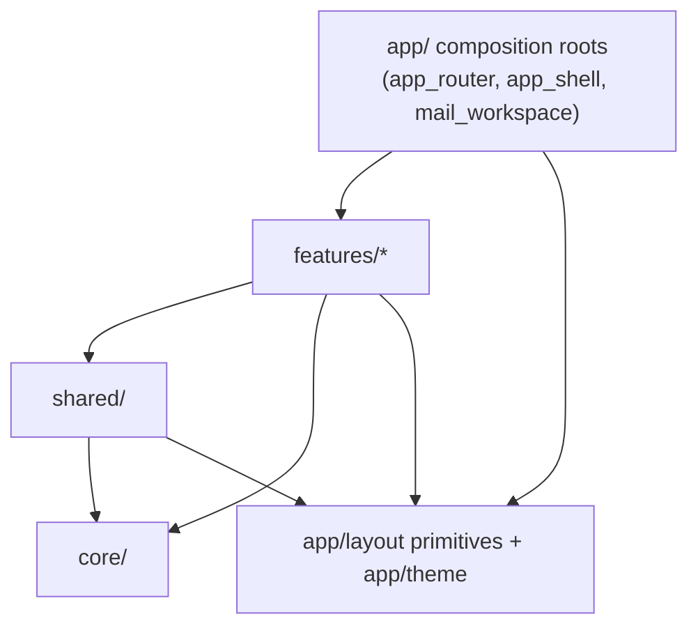

# Folder structure

```text
sokomail/
├── android/ ios/ web/        Platform projects (generated by Flutter; edit sparingly)
├── assets/                   images/, icons/, fonts/ (official logo and brand font go here)
│   └── branding/             App icon source artwork (not bundled; see ADR-019)
├── flutter_launcher_icons.yaml  Generates the Android, iOS and web icons from assets/branding/
├── docs/
│   ├── architecture/         This documentation
│   └── api/                  Notes on the Go API contract
├── integration_test/         On-device end-to-end tests
├── test/                     Unit and widget tests (mirrors lib/)
└── lib/
    ├── main.dart             Entry point: calls bootstrap()
    ├── bootstrap.dart        Platform init, persistent preferences, ProviderScope
    ├── app/                  App-wide composition
    │   ├── app.dart          MaterialApp.router (themes, scroll behaviour)
    │   ├── router/           Routes, names, paths, guard, not-found page
    │   ├── theme/            Colour tokens, brand/status extensions, typography, ThemeData
    │   └── layout/
    │       ├── adaptive_scaffold.dart   Layout slots per size class
    │       ├── app_breakpoints.dart     Window size classes
    │       ├── responsive_layout.dart   ResponsiveLayout, ListDetailLayout
    │       ├── responsive_page.dart     Secondary-page chrome + PageHeader
    │       ├── brand_app_bar.dart       Deep-green bar with the wordmark
    │       ├── pane_card.dart           Rounded card for list and reader panes
    │       ├── app_shell.dart           Composition root: shell navigation
    │       ├── mail_workspace.dart      Composition root: list + reader
    │       └── shell/                   Drawer, sidebar, bottom bar, top bar,
    │                                    theme toggle, account menu, sidebar state
    ├── core/                 Feature-independent infrastructure
    │   ├── config/           AppConfig (dart-defines, version)
    │   ├── errors/           AppFailure hierarchy, provider retry policy
    │   ├── network/          Dio factory, ApiClient, interceptors, error mapping
    │   ├── platform/         AppPlatform (capabilities, not layout)
    │   ├── security/         AccessTokenSource
    │   ├── storage/          PreferencesStore + SharedPreferencesStore
    │   └── utils/            AppLogger
    ├── shared/               Reused by several features
    │   ├── widgets/          App* basics, SokoMailLogo, BrandLandscape,
    │   │                     MessageListTile, SenderAvatar, PillLabel/CountBadge,
    │   │                     AppSearchField, MenuItemLabel,
    │   │                     PlaceholderTag/showPlaceholderNotice
    │   ├── models/           EmailAddress, MailFolder, MessageSummary,
    │   │                     Attachment, SyncStatus
    │   ├── providers/        mailDataVersionProvider (cross-feature refresh signal)
    │   ├── extensions/       Theme shortcuts, folder labels/icons, dates, file sizes
    │   └── dev/              DEVELOPMENT-ONLY sample data and DevMailStore
    └── features/
        ├── auth/             User, auth state, login, development session banner
        ├── mailboxes/        Mailbox + permissions, selector, Mailboxes screen
        ├── inbox/            Folder lists, filters, badge counts
        ├── message/          Reading view, actions, attachment cards
        ├── compose/          Compose/reply/forward/edit draft, attachment picker
        ├── drafts/           Draft entity and repository
        ├── search/           Search repository and screen
        ├── notifications/    README only (no push dependencies yet)
        ├── settings/         Appearance, account, about; settings widgets
        └── admin/            Admin-only placeholder screen
```

A folder appears when it gets its first real file. `assets/*` keep
`.gitkeep` files; declare them in `pubspec.yaml` only when they hold real
assets. `assets/branding/` is never declared: its PNGs are inputs to the
icon generator, not files the app loads.

Tools that write files are skipped tests under `test/tool/`: screenshots
(`app_screenshots_test.dart`) and the placeholder icon artwork
(`app_icon_test.dart`).

## Inside a feature

```text
features/<feature>/
├── data/
│   ├── datasources/     Remote (ApiClient), local, platform (e.g. file picker)
│   ├── models/          DTOs: JSON shape of the Go API, with mappers
│   └── repositories/    Implementations (+ DevMock*) and *_repository_provider.dart
├── domain/
│   ├── entities/        Immutable business objects (no Flutter/Dio imports)
│   ├── repositories/    Repository interfaces
│   └── usecases/        Only when logic spans several repositories
└── presentation/
    ├── screens/         Route-level widgets
    ├── widgets/         Feature-specific widgets
    └── providers/       View models (Notifier/AsyncNotifier) and FutureProviders
```

Create only the sub-folders a feature needs.

## Dependency rules



1. `core/` imports no feature, `shared/` or `app/` code.
2. `shared/` imports `core/` and the theme (`app/theme/`) only.
3. Inside a feature: `presentation -> domain <- data`. Domain imports nothing
   from data or presentation.
4. A feature may use another feature's **domain types** and its
   **repository provider** (`*_repository_provider.dart`). It must not use
   another feature's data sources, mocks, screens, widgets or view models.
   Exception: screens may read the signed-in user from `authControllerProvider`.
5. Features never import the router. Screens expose callbacks and the
   composition roots wire them to routes.
6. `app/theme/` and the layout primitives in `app/layout/`
   (`adaptive_scaffold`, `app_breakpoints`, `responsive_layout`,
   `responsive_page`, `brand_app_bar`) are leaves that features may use.
   `app_router`, `app_shell`, `mail_workspace` and `layout/shell/` are
   composition code and may import any feature.

## Where to put new code

| You are adding... | Put it in |
| --- | --- |
| A screen for an existing feature | `features/<feature>/presentation/screens/`, then a route in `app/router/app_router.dart` |
| A business area | `features/<new_feature>/` with only the layers it needs |
| A widget used by one feature | `features/<feature>/presentation/widgets/` |
| A widget used by several features | `shared/widgets/` |
| A value type used by several features | `shared/models/` |
| A colour or component style | `app/theme/` (see design_system.md) |
| An API call | `features/<feature>/data/datasources/` using `ApiClient` |
| A new failure type | `core/errors/app_failure.dart` |
| Development sample data | `shared/dev/` and a `DevMock*` repository |

## Naming conventions

- Files: `snake_case.dart`; one public widget or class per file (small
  private helpers may share it).
- Screens end in `Screen`, view models in `Controller`, repositories in
  `Repository`, DTOs in `Dto`, providers in `Provider`.
- Development-only classes start with `Dev`/`Development` and their files
  start with a `DEVELOPMENT ONLY` banner.
- Always use `package:sokomail/...` imports.
- Material widgets come from `package:material_ui/material_ui.dart`
  (decisions.md, ADR-004).
