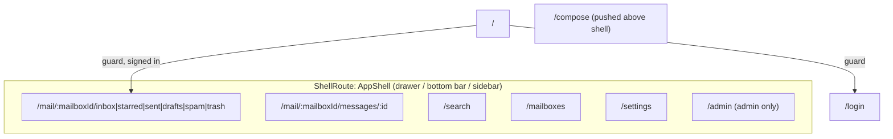

# Navigation (go_router)

All routes are declared in `lib/app/router/app_router.dart`. Route names are
in `route_names.dart`; path templates, parameter and query names, and
location builders are in `route_paths.dart`.

## Routes

| Path | Name | Access | Screen |
| --- | --- | --- | --- |
| `/` | (none) | resolved by guard | Redirects to `/login` or the user's inbox |
| `/login` | `login` | public | `LoginScreen` |
| `/mail/:mailboxId` | (none) | authenticated | Redirects to `/mail/:mailboxId/inbox` |
| `/mail/:mailboxId/inbox` | `mailInbox` | authenticated | `MailWorkspace` -> `MailFolderScreen` |
| `/mail/:mailboxId/starred` | `mailStarred` | authenticated | same, starred view |
| `/mail/:mailboxId/sent` | `mailSent` | authenticated | same, Sent |
| `/mail/:mailboxId/drafts` | `mailDrafts` | authenticated | same, Drafts (opening a draft goes to Compose) |
| `/mail/:mailboxId/spam` | `mailSpam` | authenticated | same, Spam |
| `/mail/:mailboxId/trash` | `mailTrash` | authenticated | same, Trash |
| `/mail/:mailboxId/messages/:id` | `message` | authenticated | `MailWorkspace` -> list + `MessageScreen` |
| `/compose` | `compose` | authenticated | `ComposeScreen` (pushed above the shell) |
| `/search` | `search` | authenticated | `SearchScreen` |
| `/mailboxes` | `mailboxes` | authenticated | `MailboxesScreen` |
| `/settings` | `settings` | authenticated | `SettingsScreen` |
| `/admin` | `admin` | **admin** | `AdminScreen` |
| anything else | | | `NotFoundScreen` |

### Query parameters

| Parameter | Used by | Meaning |
| --- | --- | --- |
| `folder` | message | Folder whose list is shown beside the message (default `inbox`) |
| `mailboxId` | search, compose, mailboxes, settings, admin | Mailbox context outside `/mail/...` (default: the user's primary mailbox) |
| `q` | search | Initial search text |
| `mode`, `messageId` | compose | `reply`, `replyAll`, `forward` or `editDraft`, and the message it refers to |
| `from` | login | Location to return to after sign-in (validated) |

Examples: `/compose?mode=reply&mailboxId=abc&messageId=42`,
`/search?mailboxId=abc&q=battery`.



## Navigating

Use names, not hand-built paths:

```dart
context.goNamed(
  RouteNames.message,
  pathParameters: {RouteParams.mailboxId: mailboxId, RouteParams.messageId: id},
  queryParameters: {RouteQuery.folder: folder.pathSegment},
);
```

- **`go`** for anything that should be a shareable URL (folders, messages,
  search, settings). On the web, go_router only reflects `go` navigations in
  the address bar.
- **`push`** only for transient tasks: Compose (new, reply, forward, edit
  draft) is pushed so closing returns exactly where the user was.

Feature screens do not call the router. They expose callbacks
(`onMessageSelected`, `onReply`, `onOpenSearch`, `onBack`) and the
composition roots (`app_router.dart`, `app_shell.dart`, `mail_workspace.dart`)
translate them into navigation. Shell navigation passes the current mailbox
as `mailboxId` so secondary pages keep the context.

## Authentication guard and roles

The top-level `redirect` calls `RouteGuard.redirect` (`route_guard.dart`), a
pure function covered by `test/app/router/route_guard_test.dart`:

- Signed out + protected page -> `/login?from=<original location>`.
- Signed in + `/login` -> the `from` location if it is a safe in-app path,
  otherwise the user's inbox (prevents open redirects).
- Signed in + `/` -> the primary mailbox's inbox (or `/settings` if none).
- Route requires `RouteAccess.admin` and the user is not an admin -> inbox.

Access requirements are declared with route metadata
(`metadata: RouteAccess.admin.metadata`). Routes without metadata default to
`authenticated`. Client-side guards decide navigation only; the Go API must
authorise every request.

## Back button behaviour

- **Open message:** `MailWorkspace` intercepts the Android back button and
  `Escape` and returns to the folder (works for deep links too).
- **Secondary pages** (Search, Mailboxes, Settings, Admin): `ResponsivePage`
  shows a back button on phones; system back returns to the mailbox's inbox.
- **Compose:** pushed, so back pops it; with unsaved changes it asks first
  (keep editing, discard, save draft).
- **Web:** browser back/forward follow URL history.

## Web URLs and hosting

`bootstrap.dart` calls `usePathUrlStrategy()`, so URLs look like
`https://mail.example.com/mail/abc/inbox`. The web server must serve
`index.html` for every unknown path; for a sub-path deployment build with
`flutter build web --base-href /sub-path/`.

## Adding a route

1. Add the name to `RouteNames` and the template to `RoutePaths`.
2. Add a `GoRoute` in `app_router.dart`: inside the `ShellRoute` if it needs
   the navigation chrome, at top level if it is full screen.
3. Set `metadata: RouteAccess.<level>.metadata` if it is public or admin-only.
4. If it is a navigation destination, add it in `AppShell`.
5. Add a navigation test in `test/app/router/app_router_test.dart`.
