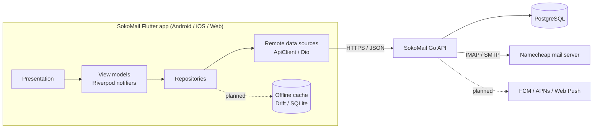
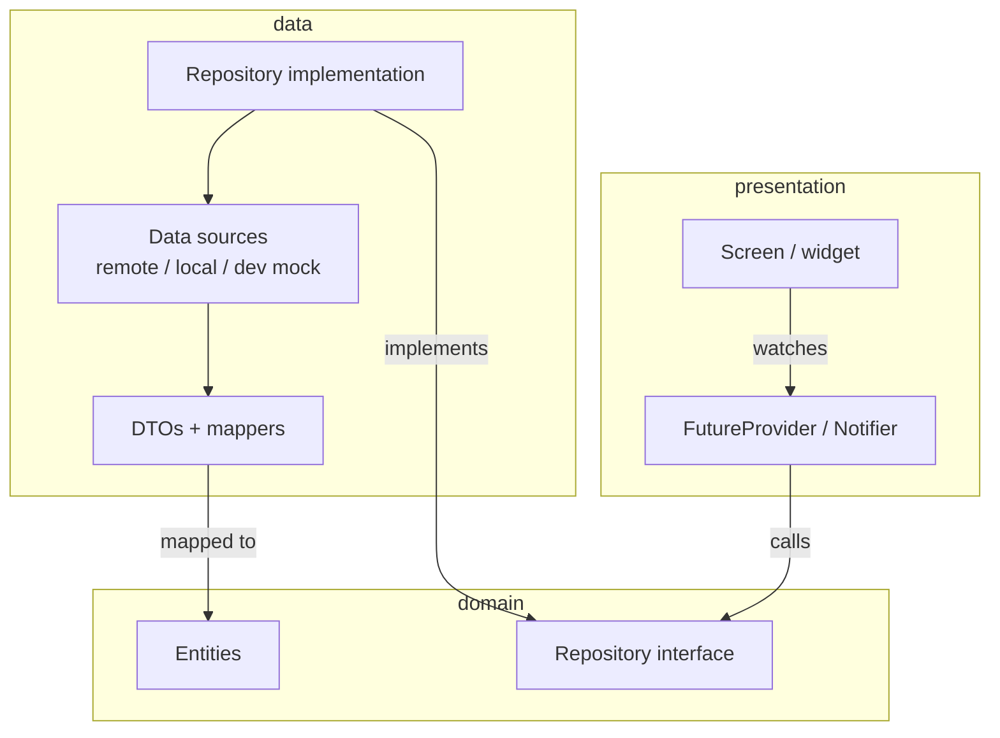

# SokoMail architecture overview

SokoMail is SokoAerial Robotics' company email client for Android, iOS and the
web, built from one Flutter codebase. This document explains how the app is
structured, why, and which parts are real versus placeholders as of Phase 1.

Related documents:

- [design_system.md](design_system.md): colour tokens, typography, components
- [folder_structure.md](folder_structure.md): where code lives and dependency rules
- [state_management.md](state_management.md): Riverpod, MVVM and testing overrides
- [navigation.md](navigation.md): routes, guards, deep links, back behaviour
- [responsive_design.md](responsive_design.md): breakpoints and adaptive layouts
- [decisions.md](decisions.md): architecture decision records
- [../api/README.md](../api/README.md): integration with the future Go API

## System context

The Flutter client never talks to the mail server. All mail operations go
through the SokoMail Go API, which holds the Namecheap IMAP/SMTP credentials
and enforces mailbox permissions.

## Architectural style

SokoMail combines four ideas, each applied only as far as it pays for itself:

| Idea | How it is applied |
| --- | --- |
| Feature-first | Code is grouped by business feature (`lib/features/inbox`, `.../compose`), not by technical type. |
| Clean Architecture layers | Inside a feature: `presentation` → `domain` ← `data`. The domain has no Flutter, Dio or storage imports. |
| MVVM | Widgets render state; Riverpod notifiers (view models) hold UI state and call repositories. |
| Repository pattern | Repositories hide where data comes from (API, cache, development fixtures) and convert errors into typed `AppFailure`s. |

Riverpod is the single mechanism for state management and dependency
injection. There is no service locator or second DI framework.

### Layers and data flow

1. A screen `ref.watch`es a provider and renders its `AsyncValue` (loading,
   data or error).
2. The provider calls a repository through its **domain interface**, obtained
   from a repository provider.
3. The repository implementation talks to data sources and returns **domain
   entities**. It throws only `AppFailure` subclasses.
4. Errors reach the screen as `AsyncError`; `AppErrorView` shows the failure's
   user-safe message, never raw exception text.

Widgets never import Dio, storage, or another feature's data layer.

## What is real and what is a placeholder (Phase 3)

| Area | Status |
| --- | --- |
| Project structure, layering, dependency rules | **Real** |
| Riverpod, go_router (guards, roles, deep links), retry policy | **Real** |
| Olive design system, light/dark/system themes | **Real**; theme and sidebar state saved on the device |
| App icons (Android, iOS, web favicon and PWA) | **Placeholder artwork** (an envelope on green), generated from `assets/branding/`; awaiting the official logo (ADR-019) |
| Responsive shell: phone drawer + bottom bar + Compose button; tablet and desktop green sidebar (collapsible) + top bar; framed list/reader panes | **Real** |
| Screen UI: login, folders (Inbox, Starred, Sent, Drafts, Spam, Trash), reader, compose, mailboxes, search, settings, admin | **Real UI** |
| Mail interactions: select, open, close, star, mark read/unread, mark all as read, delete/spam/restore, filter, sort, search, switch mailbox | **Local demo**: work against the in-memory `DevMailStore` (development builds only) |
| Compose: From, To/Cc/Bcc, subject, body, validation, reply/reply-all/forward pre-fill, choosing files, save draft | **Local demo**; files are not uploaded and drafts are not synced |
| Sending mail, attachment download/upload (incl. "Download all") | **Not available**; the UI says so |
| Archive, labels, notifications, help & support | **Placeholders**: buttons explain that they need the SokoMail API |
| Network layer (`ApiClient`, interceptors, error mapping) | **Real but unused**: no backend exists, so no requests are made |
| Authentication | **Placeholder.** Server sign-in is disabled; the development session exists only in debug/profile builds |
| Settings: account, security, notifications, language | **Placeholders**, marked "Coming soon" |
| Admin, push notifications, offline cache | **Not implemented**; placeholder screen or documentation only |

## Security model

SokoMail handles confidential company correspondence. Phase 1 establishes
these rules; later milestones must keep them.

- **No mail credentials on the client.** IMAP/SMTP passwords live only on the
  Go API. The client never connects to IMAP or SMTP.
- **The server authorises everything.** Roles (`UserRole`) and mailbox
  permissions (`MailboxPermission`) on the client only decide what to show.
  The `/admin` route guard is a convenience, not a security boundary.
- **No secrets in the codebase.** `--dart-define` values are compiled into the
  app and are extractable, so they may only hold non-secret configuration
  (environment name, API URL). `.gitignore` excludes `.env*`, key files and
  Firebase configuration.
- **Development-only code is compiled out of release builds.** The development
  session and sample data are gated by `AppConfig.developmentToolsCompiledIn`
  (`!kReleaseMode`, a compile-time constant), so the compiler removes them
  from release builds. When active, a warning banner is always visible.
- **Safe errors and logs.** `AppFailure.toString()` omits details;
  `AppErrorView` shows only `userMessage`. `SafeLoggingInterceptor` logs the
  method, path, status and timing, never headers, query strings or bodies.
  `AppLogger` is silent in release builds.
- **Release builds require HTTPS.** `API_BASE_URL` with `http://` is rejected
  when `kReleaseMode` is true.
- **Planned session handling.** Web: HttpOnly, Secure, SameSite cookies set by
  the API (tokens never readable from Dart). Mobile: short-lived access token
  in memory, refresh token in Keychain/Keystore. See `AccessTokenSource`.
- **Planned content safety.** Message bodies are shown as plain text. HTML
  bodies will need server-side sanitisation and a sandboxed renderer, which
  requires a security review before it is enabled.

## Offline storage (planned)

SokoMail stores **no mail data** on the device. The only persistent storage
is `PreferencesStore` (`lib/core/storage/`), backed by `shared_preferences`,
for allow-listed, non-sensitive preferences (theme mode, sidebar state). The
development `DevMailStore` lives in memory only and is not compiled into
release builds.

Intended design for the offline milestone:

- **Technology:** Drift over SQLite on Android/iOS; Drift's web backend
  (WASM SQLite with OPFS/IndexedDB) on the web, which needs extra web assets
  and server headers.
- **What is cached:** mailbox list, folder metadata, message summaries for
  recent messages, and bodies of recently opened messages. Attachments are
  not cached by default.
- **Protection:** cached mail must be encrypted at rest on mobile (for
  example SQLCipher with a key held in Keychain/Keystore). Caching message
  content on shared web browsers needs an explicit policy decision; the
  default should be "metadata only" on the web.
- **Lifecycle:** the cache is wiped on sign-out and when the server revokes
  access to a mailbox.
- **Sync:** repositories read from the cache first and refresh from the API;
  `SyncStatus` (in `lib/shared/models/`) describes per-item state.
- **Boundary:** repositories own caching. Presentation code never reads Drift
  directly.

## Integration with the Go API

When an endpoint is agreed with the backend team:

1. Add DTOs with `fromJson`/`toJson` in `features/<feature>/data/models/`.
2. Add a remote data source in `features/<feature>/data/datasources/` that
   uses `ApiClient` (from `apiClientProvider`) and returns DTOs.
3. Implement the domain repository in `features/<feature>/data/repositories/`,
   mapping DTOs to entities.
4. Bind it in the feature's `*_repository_provider.dart` for non-development
   builds. Keep the `DevMock*` repository for local development.
5. Test the data source with a fake `HttpClientAdapter` (see
   `test/core/network/api_client_test.dart`).

See [../api/README.md](../api/README.md) for the conventions the client
already assumes.
